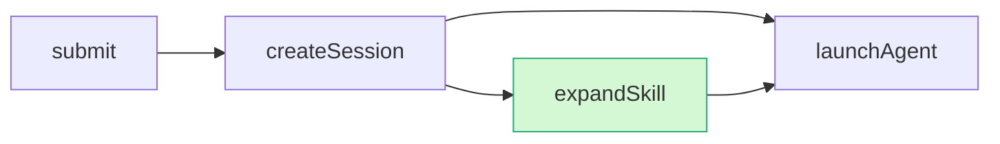

# Write a PR title and description

Pick the template for the kind of PR, copy it from `templates/`, fill it, and delete every
section it does not need. A body is a few lines per section, never a wall of text.

| The PR is | Template | Sections beyond the base |
| :--- | :--- | :--- |
| a new capability or flag (`feat`) | `templates/feature.md` | Why, Behaviour, Out of scope, Rollback |
| a bug fix (`fix`) | `templates/fix.md` | Symptom, Cause, Why it will not return |
| a restructuring (`refactor`) | `templates/refactor.md` | Why, Behaviour change (none), Review guide |
| an ADR or design doc (`docs`) | `templates/adr.md` | Decision, Context, Consequences |
| tooling, CI, dependencies (`chore`) | `templates/chore.md` | Why, Rollback |
| tests only (`test`) | `templates/test.md` | Why, Before/After rate |
| a speed-up (`perf`) | `templates/perf.md` | Measurement table, Trade-off |
| a revert | `templates/revert.md` | Why, Next |
| a task from a `pup` session | `templates/session.md` | Task, Gate, Scope |

No template fits: use the base body below.

Base body:

```markdown
## Summary

<one mermaid diagram (omit for a trivial change), at most two sentences>

## Evidence

<before -> after: one line each, or one screenshot>

## Merge Danger

**Door:** <one-way or two-way>. **Blast Radius:** <one word>.

<only if non-obvious: what a merge reaches>

Lands decision NN. Follow-up to #NNNN.
```

> **This repo has no issue tracker.** There is no ticket id in the title and no `Closes` line.
> A PR anchors itself to the numbered entry in `docs/adr/` it lands or sharpens
> (`Lands decision 56.`) and to the PRs it follows from (`Follow-up to #93.`); drop the closing
> line when neither applies. The tracker wording below is kept for reuse in a repo that has one.

## Sections

Short beats complete: a reviewer reads the diagram, not the prose. The whole body fits on one screen. Skip preambles, never restate the diff or the commit list, and drop a sentence that the diagram already says. Use the project's own language: the `SCHEMA` nouns in `src/core/db.client.ts`, the terms `docs/adr/` fixed, and the role taxonomy in `docs/conventions/naming.md`.

### Summary

One Mermaid diagram that shows the shape of the change, then at most two sentences on why. Pick the diagram type by what the change is:

| The change is | Diagram |
| :--- | :--- |
| a control or data flow, a pipeline, a call path | `flowchart` |
| components talking to each other over time | `sequenceDiagram` |
| a lifecycle or state machine | `stateDiagram-v2` |
| entities and how they relate (a `SCHEMA` change) | `erDiagram` |
| modules, types or responsibilities | `classDiagram`, or a `flowchart` of module boxes |

Show what changed, not the whole system: draw only the nodes the reader needs, and mark the change with `classDef` (`added`, `removed`, `changed`) so the diff reads at a glance.



Define every class you use; an undefined one renders unstyled with no error. Skip the diagram when it adds nothing: a one-line config or docs-only change gets one sentence. Use a fenced `diff` block only for a change too small to draw, and never paste a file tree, a pseudocode block or a whole function.

### Evidence

One line each for before and after. A screenshot is best for a visual change. Otherwise name the test that now passes and the one-line result it gave, or the command and its output trimmed to the line that matters. Never paste a log.

### Merge Danger

**Door:** one-way when the change is destructive or hard to reverse, otherwise two-way. **Blast Radius:** one word from `none`, `docs`, `cli`, `gate`, `store`, `sessions`, `fleet`. Add a sentence only when what a merge reaches is not obvious from those two.

Doors worth naming in this repo: a `SCHEMA` or `MIGRATIONS` change in `src/core/db.client.ts` reaches every store under `~/.pupitre/` on next open (additive and nullable, and what an older store does); a gate stage, compiled hook, or profile-compiler change reaches every session launched after it merges, the conductor's included; anything that shells out (`git`, `gh`, `tmux`, `claude -p`) is where the security review looks, so name what a session-controlled worktree could feed it.

## Workflow

1. **Gather context** (run together):

   The trunk is `GIT_TRUNK` from `.claude/project.env` (default `main`); substitute it below.

   ```sh
   git branch --show-current                              # MUST NOT be the trunk; abort if it is
   git log <trunk>..HEAD --pretty=format:'%h %s%n%b'         # commits on this branch
   git diff <trunk>...HEAD --stat                            # changed files + churn
   gh pr view --json number,url,state,title,body 2>/dev/null   # non-zero exit = no PR yet
   ```

   Read the diff for the key files (`git diff <trunk>...HEAD -- <path>`); on large diffs lean on `--stat` plus the important files.

2. **Ground in the decisions log (read-only).** Grep the diff and commit bodies for `decision \d+` and read those entries in `docs/adr/`; grep `git log <trunk>..HEAD` for `#\d+` to find the PRs this one follows from. A PR that edits the decisions log lands the entry it adds. No decision touched: derive from diff + commits.

3. **Draft title + body together.** Start from the template in the table above. Title per [Title format](#title-format); body to a temp file (`mktemp`) per the template and [Sections](#sections), obeying [Body rules](#body-rules). For an existing PR, treat the current title and body as a draft, not a constraint.

4. **Create or update the PR.** Show the drafted **title** and **body** + the exact `gh` command; quick confirm before running (notifies reviewers + CODEOWNERS) unless told to just do it.

   ```sh
   git rev-parse --abbrev-ref --symbolic-full-name @{u} 2>/dev/null || git push -u origin "$(git branch --show-current)"
   # update existing; pass --title only if it changes:
   gh pr edit <number> --body-file <tmp> [--title "<drafted title>"]
   # or create new:
   gh pr create --base <trunk> --title "<drafted title>" --body-file <tmp>
   ```

   Report the PR URL.

## Title format

Communicate *what changed and why* at a glance, specific enough that a reviewer can predict the diff. GitHub auto-appends ` (#NNNN)` on merge; do not write it yourself.

```
<type>(<scope>): <summary> (PROJ-XXXX)
```

- **`<type>`**: dominant intent of the diff.

  | Type       | Use for                                     |
  | :--------- | :------------------------------------------ |
  | `feat`     | New feature or capability                   |
  | `fix`      | Bug fix                                     |
  | `refactor` | Code restructuring with no behaviour change |
  | `docs`     | Documentation only (includes ADRs)          |
  | `test`     | Adding or updating tests                    |
  | `chore`    | Build config, dependencies, tooling         |
  | `perf`     | Performance improvement                     |

  Mixed diff: pick the user-visible win, mention the rest in the Summary.
- **`<scope>`**: optional but usually present. Lowercase kebab, naming the component or area touched. Common scopes in this repo: `gate`, `cli`, `ui`, `conductor`, `watch`, `profile`, `init`, `store`, `adapters`, `claude`, `report`, `tooling`, `skills`, `deps`. Multi-scope `(gate,cli)` only when both are non-trivial. Drop the scope when the change is repo-wide.
- **`<summary>`**: imperative present tense, lowercase first word, no trailing period. Proper nouns keep their case (`Biome`, `SQLite`, `Vitest`, `GitHub`); double quotes around identifiers are fine.
- **`(PROJ-XXXX)`**: a tracker id; there is none here, so drop it. Follow-ups read `(follow-up to #NNNN)`.

**Lint:**

- No em-dash (`—` / `–`). Hyphen, colon, or rephrase.
- No trailing period; no capital after the colon (proper nouns excepted).
- ≲ 80 chars including `(PROJ-XXXX)`; if over, trim adjectives, not specificity.
- Reject generic verbs (`update`, `improve`, `change`, `various`). Strong fix-title names cause, surface, impact: `fix(api): race condition in cache invalidation that caused 502s under load`, not `fix bug`.

**Worked examples:**

| Diff shape                          | Title |
| :---------------------------------- | :---- |
| Gate change landing a decision      | `fix(gate): keep test files and other checkouts out of the coverage report` |
| Targeted store bug                  | `fix(store): resolve the ambiguous "id" in the backlog listing` |
| Decision landing ahead of impl      | `docs: record decision 57 on the post-Bash scope re-check` |
| Follow-up to a prior PR             | `chore(skills): take the template's implement and wayfinder skills (follow-up to #93)` |
| Repo-wide change, no scope          | `feat: drop PUP_SESSION_ID from every tmux client env` |

## Body rules

- **No em-dash** (`—` / `–`). Hyphen or colon.
- **No hardcoded hostnames/URLs.** Derive from config; link tracker issues by id/URL only.
- **Anchor, don't close.** End the body with `Lands decision NN.` when the PR adds or sharpens an entry in `docs/adr/`, and `Follow-up to #NNNN.` when it continues an earlier PR; GitHub links the `#NNNN`. No `Closes` line: there is no tracker to close anything on.
- **No attribution footer.** Never add `🤖 Generated with Claude Code` (or any agent attribution) to the PR body. The `Co-Authored-By` trailer on commits is the only attribution.

The Summary diagram guidance is adapted from Dex Horthy's `show-me` skill (humanlayer/skills).
