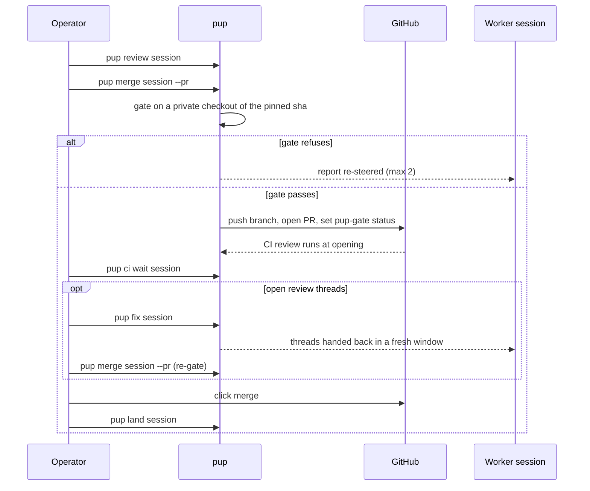
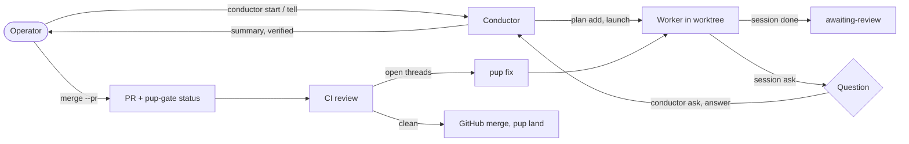

# Command guide

Commands by workflow. This page says when to reach for each one; `pup <command> --help` lists every
flag. Sessions and the conductor are refused the ones marked *operator*; the reasons are in the
decisions linked from [Concepts](concepts.md#glossary).

## Reading the help

```bash
pup --help             # all commands
pup <command> --help   # flags of one command
pup --project <id> status   # act on a registered project from anywhere
```

Outside a repo, `pup status` and `pup ui` show the fleet: every registered project
([decision 60](../adr/0060-outside-a-repo-pup-status-is-the-fleet.md), [61](../adr/0061-pup-ui-all-is-the-fleet-on-one.md)). `pup project list|dormant|wake` (*operator*) manages the
registry; a dormant project is hidden unless you pass `--dormant` ([decision 62](../adr/0062-a-project-can-be-put-to-sleep-and.md)).

## Plan

| Command | Use |
| --- | --- |
| `pup plan` / `pup plan list` | The backlog: tasks with no session yet |
| `pup plan add "<goal>" --scope <glob...> --scope-out <glob...> --accept <criterion...> [--tier critical\|standard]` | Add a task. *Operator or conductor* |
| `pup plan edit <task> [--goal ...] [--scope-out ...] [--accept ...] [--tier ...]`, or `pup plan edit <task> --rescope --scope <glob...>` | Change a task; `--rescope` (*operator*, and alone on the command) only appends to the scope-in of a claimed task ([decision 115](../adr/0115-pup-plan-edit-rescope-lets-the-operator-widen.md)) |
| `pup plan drop <task>` | Retire a task whose sessions were all killed ([decision 147](../adr/0147-pup-plan-drop-retires-a-task-whose-sessions-were-all.md)) |
| `pup brief show\|edit` | The project brief; both refused to sessions and the conductor (*operator*) |
| `pup intent new\|show\|list\|accept` | Intents; `accept` is *operator* ([decision 126](../adr/0126-an-intent-is-a-file-under-docs-intent-the.md)) |

## Launch

| Command | Use |
| --- | --- |
| `pup new <goal> --scope ... --accept ...` | Create the task, compile a profile, make the worktree, start the session (*refuses worker sessions*) |
| `pup launch <task>` | Start a session for a task already in the backlog (*operator or conductor*) |
| `pup conductor start` | Start the conductor (*operator*). `stop` and `tell <message>` are *operator* too; `recap` prints the fleet as the store and git hold it and is also open to the conductor; the conductor asks you with `ask <question> [--option ... --recommend <n>]` ([decision 85](../adr/0085-pup-attach-hands-the-terminal-to-the-conductor.md)) |
| `pup attach [session]` | (*operator*) Put this terminal on the conductor's or a session's tmux window; Ctrl-b d detaches |

`pup new` and `pup launch` take `--model` and `--effort` to override the routed ones
([decision 92](../adr/0092-pup-routes-every-window-s-model-and-effort.md)). They are refused while the merge lock's backlog, the machine's load or the
plan's usage windows are over their limits; `--over-cap` and `--over-limit` override that
(*operator*; [decision 197](../adr/0197-launches-follow-the-merge-lock-s-backlog-and-the.md), [156](../adr/0156-launches-hold-while-the-plan-s-usage-windows-run-low.md)). `--allow-overlap` does nothing any more.

## Steer

| Command | Use |
| --- | --- |
| `pup steer <session> <message>` | Type a correction into a running session. It cannot stop a turn already under way ([decision 4](../adr/0004-steering-cannot-force-interrupt-a-mid-turn-agent.md)) |
| `pup interrupt <session> [message]` | Press Escape on the in-flight tool call, optionally with a message ([decision 37](../adr/0037-force-interrupt-is-its-own-command-and-every.md)) |
| `pup answer <target> <reply>` | Answer a session's open question, or the conductor's with target `conductor`; a reply may be an option's number (*operator*; [decision 93](../adr/0093-a-question-offers-numbered-options-and-pup-answer.md)) |
| `pup unblock <session> [--reason <text>]` | Return a blocked session to running once you dealt with the block (*operator*) |
| `pup respawn <session> [--wait <seconds>]` | Ask for a handoff, then relaunch on a fresh context (*operator*; [decision 200](../adr/0200-compaction-is-the-default-context-reset-respawn-is.md)) |
| `pup kill <session> [--respawn]` | Stop a session (*operator or conductor*); `--respawn` relaunches it fresh with no handoff (*operator*) |

## Status

| Command | Use |
| --- | --- |
| `pup status` | What needs you first, then live sessions by state, planned work and overdue debt. `--history` adds merged and killed ([decision 83](../adr/0083-pup-status-opens-with-a-needs-you-inbox.md)) |
| `pup ui` | The same in a live terminal dashboard, plus backlog, debt and the conflict radar ([decision 52](../adr/0052-pup-ui-is-ink-over-one-snapshot-and.md)) |
| `pup watch [--once\|--start\|--stop]` | (*operator*) The conflict radar: same-file overlaps between live diffs. `--start` runs it in a detached tmux session ([decision 20](../adr/0020-conflict-radar-is-a-tmux-supervised-watcher-daemon.md)) |
| `pup dashboard [--open]` | A live web page on 127.0.0.1 behind a per-run token (*operator*). It answers, steers, launches, gates and lands too ([decision 91](../adr/0091-pup-dashboard-serves-a-read-only-live-page.md), [98](../adr/0098-pup-dashboard-is-a-set-of-sheets-figures.md)) |

## Review

`pup review` lists branches awaiting review in risk order; `pup review <session>` shows one:
diff, scope, gate results, and the task's design. `pup map [module]` (`--open` for the mind-map)
and `pup log [module]` show what exists and what was decided.

## Merge

`pup merge <session>` runs the [gate](gate-and-debt.md) and merges fast-forward only on pass
(*operator*; [decision 16](../adr/0016-merge-is-ff-only-with-full-cleanup.md)). `--pr` pushes the branch and opens a pull request instead
([decision 26](../adr/0026-pup-merge-pr-same-gate-pull-request-instead.md)); the conductor may run that form but never the local merge
([decision 75](../adr/0075-the-conductor-gates-a-branch-with-pup-merge.md)). A flagged shortcut needs `--accept-debt <reason>`, with `--review-by` and
`--approved-by`. `--gate-env <names>` passes extra environment variable names to gate children.

### The operator PR loop



## Land

`pup land <sessions...>` (after the PR merged on GitHub) fast-forwards main, cleans up each session
and audits once ([decision 84](../adr/0084-pup-land-session-closes-the-github-half-of.md), [195](../adr/0195-pup-land-takes-several-sessions-and-audits-once.md)). Refusals and their flags:

`pup land` is open to the operator and the conductor, but the three flags below are *operator* only:

| Situation | Flag |
| --- | --- |
| PR head moved past the pinned sha, you read the commits between | `--accept-head <sha>` ([decision 164](../adr/0164-pup-land-takes-a-moved-head-on-the-operator-s-word.md)) |
| Same, if the gate's stages pass on the merge | `--remeasure` (with `--approved-by <who>` for critical areas) ([decision 185](../adr/0185-pup-land-remeasure-takes-a-moved-head-on-the.md)) |
| PR closed unmerged on GitHub | `--abandon-closed` |
| Several lands, one audit | `--no-audit`, then `pup audit` once |

`pup retire <session> --superseded-by <pr>` (*operator*) closes a merged session whose PR was closed because
another PR re-landed the work ([decision 141](../adr/0141-pup-retire-closes-out-a-session-whose-pr-another.md)).

## Fix

`pup ci wait <session-or-PR> [--timeout <minutes>]` blocks until the CI review finished on the PR's current head and
prints one digest line. `pup fix <session>` (*operator or conductor*) hands the open review threads of a merged session's PR
back to its worker in a fresh window (`--finding` is the conductor's alone, for a round past the top rung, [decision 202](../adr/0202-the-conductor-runs-a-fix-round-past-the-top-rung-for.md)); then `pup merge <session> --pr` re-gates the pushed fix and
`pup land` lands it ([decision 90](../adr/0090-pup-fix-session-hands-the-ci-review-s.md), [86](../adr/0086-pup-merge-session-pr-re-gates-a-merged.md), [151](../adr/0151-ci-review-runs-at-opening-and-on-demand-only.md)).

### Conductor, worker and CI review



## Knowledge and debt

| Command | Use |
| --- | --- |
| `pup log [module]` | Decision records, newest first |
| `pup map [module] [--open]` | Code map |
| `pup report [--open]` | The project report (sessions with intent, drift, debt, decisions) as HTML, under `~/.pupitre/<id>/` |
| `pup debt` | Open ledger entries, oldest first |
| `pup debt close <id>` | Close an entry once a merge removed the shortcut (*operator*) |
| `pup audit [--sweep]` | Re-measure and report drift against the baseline; `--sweep` spawns a deletion-only session (*operator*; [decision 48](../adr/0048-pup-audit-is-operator-only-the-thing-that.md)) |

## Cost

`pup usage [--since <date>] [--json]` and `pup retro [--since <days>] [--out <dir>] [--json]`
(*operator*) read the Claude transcripts locally; see [best practices](best-practices.md#prompt-caching-and-where-the-spend-goes).

## Session-internal commands

`pup session done|ask|recap|test|handoff-done` are run by the agent, not by you.
`pup session test <files>` runs related tests once a machine-wide slot is free and exits 75 if the
slots stayed busy ([decision 96](../adr/0096-test-runs-queue-for-a-few-machine-wide.md)).
