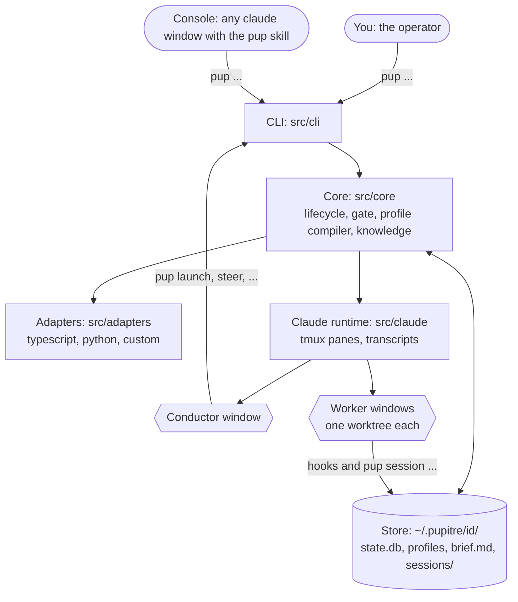
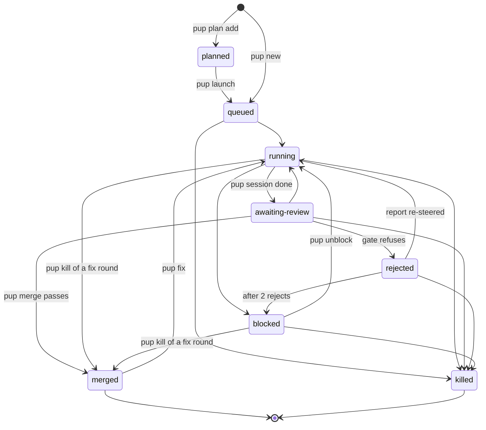
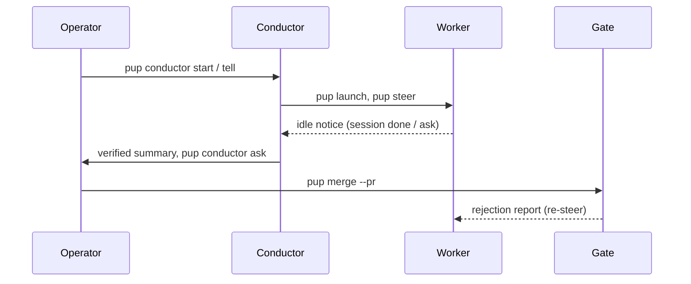

# Concepts

Design rationale is in [00 Overview](../00-overview.md) and [01 Architecture](../01-architecture.md)
(partly stale: the decisions win). This page is the vocabulary and the shape of the system.

## The pieces

Module boundaries: the CLI parses and prints, `core` decides, `adapters` run a language's
toolchain, `claude` talks to tmux and transcripts. See
[01 Architecture](../01-architecture.md) and [decision 116](../adr/0116-code-layout-string-enums-and-a-mirrored-test-tree.md) for the layout.

## Glossary

**Task.** A spec: goal, scope-in globs, scope-out globs, acceptance criteria. It can exist before
any session (the *backlog*, `pup plan`); the backlog is derived, not stored
([decision 40](../adr/0040-a-task-can-exist-before-a-session-the.md)).

**Session.** One interactive `claude` in a tmux window working one task
([decision 1](../adr/0001-sessions-are-interactive-claude-in-tmux-panes.md)). Its id is `t-<base36 timestamp>`. Everything about its state is derived from
hooks and the transcript ([decision 2](../adr/0002-all-session-state-comes-from-hooks-and-transcript.md)).

**Worktree.** The session's private checkout, `.worktrees/<id>`, on branch `pup/<id>`, made and
removed by pup. Nothing runs on a shared checkout.

**Scope.** The globs the session may edit. A PreToolUse hook refuses other edits; Bash is checked
best-effort and re-checked after each call ([decision 6](../adr/0006-bash-scope-checking-is-best-effort.md), [decision 63](../adr/0063-every-bash-call-is-re-checked-against-the.md)).

**Conductor.** One optional Claude session that plans, launches, steers and reports. It acts for the
operator on sessions, but is refused the commands marked *operator* in the [command guide](commands.md),
the local merge among them ([decision 47](../adr/0047-a-conductor-session-is-the-operator-s-delegate.md)).

**Operator.** You, or a Claude window you opened by hand. Some commands refuse everyone else, and
the [command guide](commands.md) marks each. Among them:
`pup kill --respawn` ([47](../adr/0047-a-conductor-session-is-the-operator-s-delegate.md)), `pup merge` (the local form; the conductor may gate with `--pr`, [75](../adr/0075-the-conductor-gates-a-branch-with-pup-merge.md)) and `pup respawn` ([44](../adr/0044-a-session-reports-only-its-own-state-and.md)),
`pup audit` ([48](../adr/0048-pup-audit-is-operator-only-the-thing-that.md)), `pup init` ([64](../adr/0064-pup-init-is-operator-only-like-pup-audit.md)), `pup dashboard` ([91](../adr/0091-pup-dashboard-serves-a-read-only-live-page.md)),
`pup usage` ([122](../adr/0122-pup-usage-reports-where-the-claude-usage-went-from-the.md)), `pup retro` ([150](../adr/0150-pup-retro-reads-the-claude-code-traces-locally-and.md)), `pup unblock`, `pup answer`, `pup attach`, `pup watch`, `pup brief` and `pup retire`.

**Gate.** The pipeline `pup merge` runs on a branch. See [the gate and debt](gate-and-debt.md).

**Baseline.** The metrics `pup init` measured. The gate compares deltas to it and tightens it on
improvement (the *ratchet*).

**Debt and ledger.** A flagged shortcut that merges only with `--accept-debt`. Each one becomes a
ledger entry with a reason, an approver and a review-by condition.

**Profile.** Versioned layers (base, role, task) compiled into each session's `CLAUDE.md`,
settings and hooks, and hashed. See [configuration](configuration.md#profiles).

**Intent.** A file `docs/intent/NNNN-<slug>.md` in your repo, written before the work: problem,
outcome, constraints, open questions, and two or three questions you must be able to answer after
review. Only you accept it ([decision 126](../adr/0126-an-intent-is-a-file-under-docs-intent-the.md)).

**Brief.** One Markdown file per project, `~/.pupitre/<id>/brief.md`. Destination and Constraints
go to every session, Priorities only to the conductor ([decision 57](../adr/0057-a-project-has-one-brief-written-by-the.md)).

**Ledger of decisions.** Every merge writes a decision record: `pup log`.

## Session lifecycle

`planned` is a task with no session row. The stored states and edges are in
`src/core/session-state.utils.ts`; `merged` returns to `running` only through `pup fix`
([decision 90](../adr/0090-pup-fix-session-hands-the-ci-review-s.md)). A rejection re-steers the session with the gate report; after two
([decision 7](../adr/0007-rejection-re-steer-is-capped-at-2.md), counting rebase conflicts: [15](../adr/0015-rebase-conflict-re-steers-count-toward-the-reject.md)) it is blocked for you.

*Stalled* is not a state: a running session whose events file has gone quiet is flagged by
`pup status` ([decision 35](../adr/0035-a-running-session-is-stalled-by-events-file.md)).

## Who talks to whom

The worker only reports its own state (`pup session ...`, [decision 44](../adr/0044-a-session-reports-only-its-own-state-and.md)). The conductor
cannot merge. Detailed flow with CI review is in the [command guide](commands.md#conductor-worker-and-ci-review).
