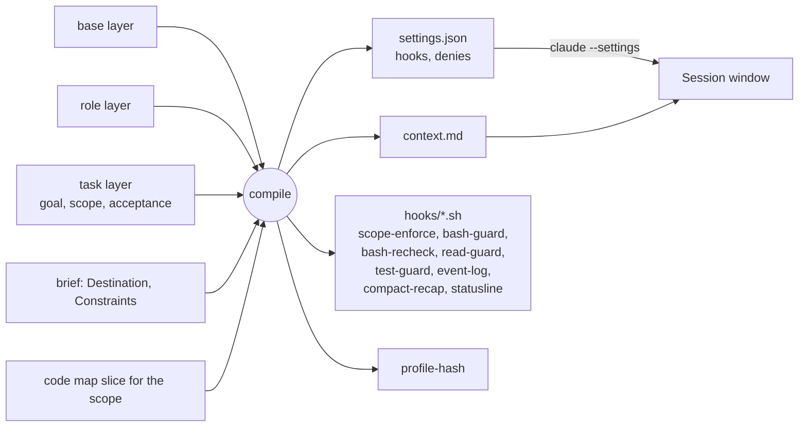

# Configuration and profiles

Design: [03 Profiles](../03-profiles.md) and [07 Onboarding](../07-onboarding.md), both partly
stale (see the corrections below). Nothing here is committed to your repo except the optional
`.pupitre/project.yml`, `.pupitre/` custom-adapter files and intents.

## Where things live

```
~/.pupitre/<project-id>/
  state.db              sessions, tasks, events, ledger, decision records, baseline
  brief.md              the project brief (pup brief edit)
  profiles/             your profile layers, YAML, one file per layer
  sessions/<id>/        events.jsonl, handoff.md, compiled/
  conductor/            the conductor's compiled profile
  retro/                pup retro reports
  report.html, map.html pup report, pup map --open
<repo>/.worktrees/<id>  a session's worktree, branch pup/<id>
<repo>/.pupitre/project.yml   optional project settings
<repo>/docs/intent/     intents, tracked in your repo
```

`<project-id>` is the first 12 hex characters of a hash of the repo path.

## Project settings: `.pupitre/project.yml`

Unknown keys are an error. Defaults apply when the file or a key is absent.

| Key | Default | Meaning |
| --- | --- | --- |
| `skipTestsOnUntestedChanges` | `true` | The gate skips the test stage when no testable file changed ([139](../adr/0139-the-gate-skips-the-test-stage-when-no-testable-file.md)) |
| `workerSandbox` | `false` | Run a worker's Bash in Claude Code's sandbox; macOS only, an error elsewhere ([191](../adr/0191-a-worker-s-bash-calls-can-run-in-claude-code-s.md)) |
| `lockBacklogBudgetMinutes` | `60` | Launches are refused past this many minutes of queued merge-lock use; 1 to 1440 ([197](../adr/0197-launches-follow-the-merge-lock-s-backlog-and-the.md)) |
| `loadAllowanceFactor` | `1` | Multiplier on the machine-load limit for launches; 1 to 3, an out-of-range value falls back to 1 ([197](../adr/0197-launches-follow-the-merge-lock-s-backlog-and-the.md)) |
| `autoCompactWindow` | `150000` | The context size Claude Code compacts around; 100000 to 1000000 ([200](../adr/0200-compaction-is-the-default-context-reset-respawn-is.md)) |

(`docs/07-onboarding.md` calls the file `.pupitre.yml`; the code reads `.pupitre/project.yml`.)

## Environment variables

Gate children and capability commands get an allowlisted environment, not yours
([decision 28](../adr/0028-gate-and-capability-children-get-an-env-allowlist.md), [36](../adr/0036-gate-children-run-inside-a-pup-generated-sandbox.md)). Add names with `--gate-env A,B` on `pup init`, `pup merge`,
`pup land` or `pup audit`. `pup init --session-env A,B` names variables every session and conductor
window inherits from the launching shell: `CLAUDE_CONFIG_DIR` and the effort, subagent-model and
telemetry ones only; they stay until the next `--session-env`, and `""` clears them
([decision 106](../adr/0106-pup-init-session-env-a-b-names-the.md)). `pup init --origin-moved` re-records the push target after origin
legitimately moved ([decision 56](../adr/0056-the-push-target-is-recorded-at-setup-and.md)).

## Adapters

`pup init` detects a TypeScript or Python adapter and fails if none matches. A custom adapter is a
set of `sh -c` commands with a JSON stdout contract under `.pupitre/`
([decision 24](../adr/0024-custom-adapter-escape-hatch-sh-c-commands-with.md), [06 Adapters](../06-adapters.md)).

## Profiles

A profile is YAML layers: `base` always, then a role, then a generated task layer. A layer can
set `extends`, `conventions`, `skills`, `subagents`, `hooks`, `deny`, `mcp` and `contextBudget`.
The built-in base layer is four conventions and a 6000-token budget; override it by writing
`profiles/base.yml`. `deny` only adds to the tools pup already denies in every window, never
removes one ([decision 77](../adr/0077-a-profile-layer-can-deny-tools-and-can.md), [74](../adr/0074-a-worker-is-kept-off-the-screens-pup.md)).



The output is written to `~/.pupitre/<id>/sessions/<id>/compiled/` and handed to the window with
`--settings` ([decision 10](../adr/0010-compiled-profile-is-delivered-per-session-via-settings.md)); repo-local settings are not loaded
([decision 19](../adr/0019-sessions-do-not-load-repo-local-settings-setting.md)), but your `~/.claude` is inherited ([decision 9](../adr/0009-sessions-inherit-the-user-s-claude.md)). The hash is
recorded on the session so drift is detectable.

```bash
pup profile list        # NAME, EXTENDS, BUDGET of each layer
pup profile show base   # one layer
```

`pup profile edit` and `pup profile stale` print "not implemented yet": edit the YAML under
`~/.pupitre/<id>/profiles/` directly.

## Routing: model and effort

Each task has a tier: *critical* when a scope-in glob can name a file in the gate, git, store,
sandbox, hooks or profile compilation (`CRITICAL_AREAS` in `src/core/routing.utils.ts`), else
*standard*. `--tier` on `pup plan add|edit` overrides it. See [best practices](best-practices.md#model-tiers-and-the-rung-ladder).
