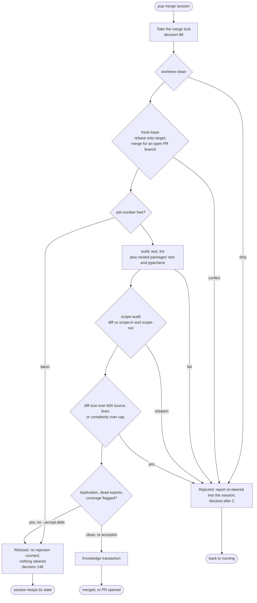
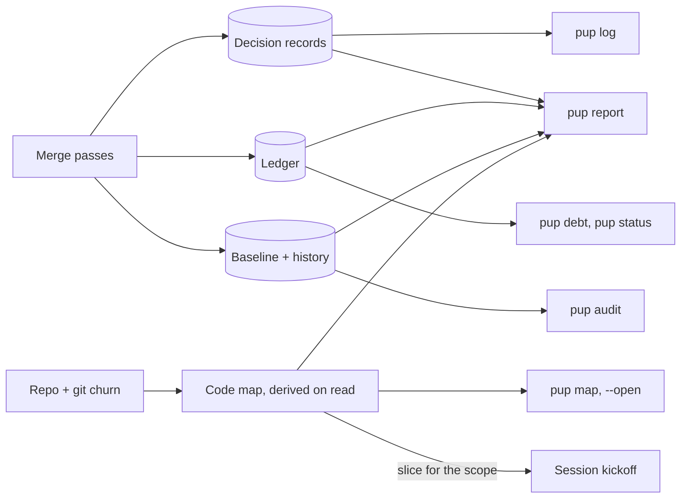

# The gate and debt

`pup merge` is the only way a branch reaches main. The design intent is in
[04 Gates and debt](../04-gates-and-debt.md); that page predates several decisions, so this one
follows the source (`src/core/merge-gate.service.ts`) and the decisions.

## Pipeline



Stages in order, from the source:

1. **worktree-clean, fresh-base, adr-number.** Uncommitted work, a conflicted rebase, or an ADR number
   the target or another open branch already holds refuses the merge
   ([decision 8](../adr/0008-fresh-base-gating.md), [146](../adr/0146-the-gate-refuses-an-adr-number-the-target-or.md), [190](../adr/0190-fresh-base-merges-the-target-into-a-branch-that.md)). A branch an open PR holds is never
   rebased; the target is merged into it ([decision 105](../adr/0105-a-branch-an-open-pr-holds-is-never.md)).
2. **build, test, lint**, run in a private detached checkout of the pinned sha
   ([decision 81](../adr/0081-the-gate-s-stages-run-on-a-private.md)). A failed test stage is re-run once ([decision 94](../adr/0094-worker-windows-run-at-nice-10-workers-run.md)); the gate skips tests when no testable file
   changed ([decision 139](../adr/0139-the-gate-skips-the-test-stage-when-no-testable-file.md)). A command is capped at 25 minutes ([decision 138](../adr/0138-a-test-stage-that-times-out-under-load-refuses.md)).
   A directory with its own `package.json` is its own unit, and its `test` and `typecheck` run
   when the diff touches it ([decisions 58, 59](../adr/0059-a-nested-package-s-own-runner-is-a.md)).
3. **scope-audit.** Diff paths against scope-in and scope-out, including violations logged during the session.
4. **Flags.**

| Flag | Counts | `--accept-debt` clears it? |
| --- | --- | --- |
| diff-size | more than 600 changed source lines; tests, lockfiles and docs excluded ([110](../adr/0110-the-diff-size-flag-counts-source-lines-only.md)) | No: split the task ([173](../adr/0173-the-diff-size-and-complexity-caps-are-hard-and.md)) |
| complexity | +15 decision points on a touched file, 50 for a new file | No ([173](../adr/0173-the-diff-size-and-complexity-caps-are-hard-and.md), [145](../adr/0145-the-complexity-stage-judges-a-new-file-on-its.md)) |
| duplication | new duplicated normalized lines in production code ([21](../adr/0021-debt-delta-three-soft-stages-with-a-merge.md), [39](../adr/0039-duplication-does-not-count-test-fixture-duplication.md)) | Yes |
| dead exports | unused exports newly introduced ([21](../adr/0021-debt-delta-three-soft-stages-with-a-merge.md)) | Yes |
| coverage | patch coverage of changed code vs the baseline ([23](../adr/0023-patch-coverage-lands-as-the-fourth-soft-stage.md), [30](../adr/0030-changed-code-absent-from-the-coverage-report-is.md)) | Yes |

A stage that could not measure says so ("not measured"); it never passes silently
([decision 29](../adr/0029-capabilities-take-a-two-path-context-and-say.md), [53](../adr/0053-a-null-numstat-is-a-measurement-not-a.md)).

5. **Knowledge transaction.** On pass: a decision record, a ledger entry per accepted flag, and the
   baseline set to what was just measured. Open ledger entries on files the diff touched are listed
   as candidates for `pup debt close`.

On `pup merge --pr` the gate then pushes the pinned sha, opens the PR and sets a `pup-gate`
status that branch protection can require ([decision 182](../adr/0182-pup-merge-pr-sets-a-pup-gate-status-on.md)). The title is a commit subject
a squash merge can land as is ([decision 137](../adr/0137-the-pr-title-is-a-commit-subject-a-squash.md)).

## Baseline and ratchet

`pup init` stores the baseline; each merged gate sets it to the values just measured, so quality
only tightens, and movement the ledger owns does not re-flag later sessions
([decision 21](../adr/0021-debt-delta-three-soft-stages-with-a-merge.md)). `pup audit` re-measures and reports drift, including the debt baseline
([decision 34](../adr/0034-pup-audit-diffs-the-debt-baseline-too-not.md)); history is append-only ([decision 38](../adr/0038-baseline-drift-is-a-new-append-only-baseline.md)). `pup audit --sweep`
spawns a deletion-only session from its findings.

## Debt

```bash
pup merge t-abc --pr --accept-debt "duplicates the retry helper until payments v2" \
  --review-by "before adding a second payment provider" --approved-by alexis
pup debt             # open entries, oldest first
pup debt close 3     # operator only, once a merge removed the shortcut
```

`--approved-by` defaults to `human` and is required from the conductor ([decision 75](../adr/0075-the-conductor-gates-a-branch-with-pup-merge.md)).
Entries past their review-by condition show in `pup status`.

## Knowledge layer



The code map is not stored: it is computed from the repo and the store when read, and a slice of
it covering the task's scope is put into the session at launch. See
[05 Knowledge layer](../05-knowledge-layer.md).
