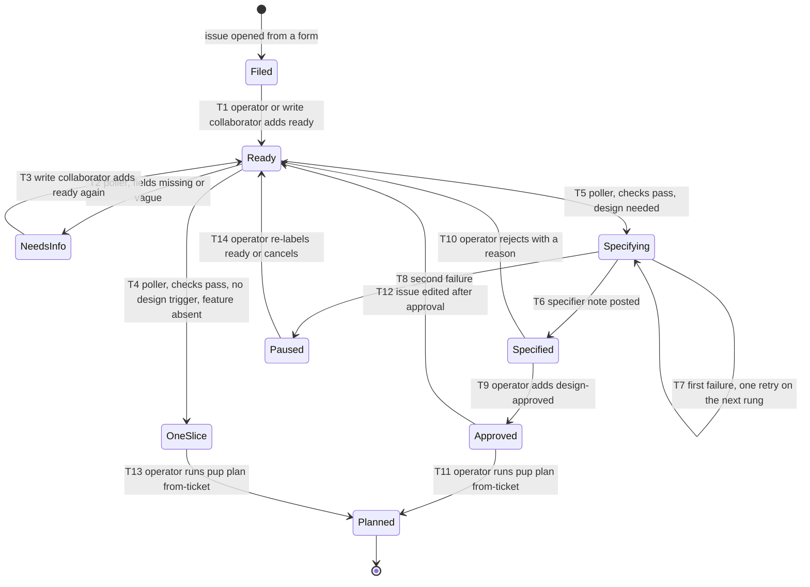

# Spike: the ticket pipeline, from a `ready` issue to planned tasks (2026-11-23)

Decision 176 made GitHub Issues the tracker and named an intake agent, a design
note and a `design-approved` label. Decision 187 built the other end: a task
can carry a copy of its ticket. The middle does not exist. `githubTracker`
(`src/core/github-tracker.service.ts`) has no caller outside tests,
`checkTicketIntake` (`src/core/ticket-intake.utils.ts`) is called by nothing,
and `/triage` is how an issue becomes work today. This spike designs the
middle: a poller picks up `ready` issues, a read-only specifier session writes
the design, the operator approves it, and the approved design becomes planned
tasks. Nothing is built here.

**Verdict: four labels and one new internal state carry the pipeline; the
poller lives in `pup watch`; the specifier is a read-only worker that never
holds `gh` and hands its note to pup, which posts it; an approved design
becomes tasks through one new operator-run command, `pup plan from-ticket`.
Four decisions are amended (176, 187, 92, 177), plus a setting under decision
178. The plan is 7 tasks.**

Facts this rests on, read from the code and decisions today:

- `listReady()` returns an open issue only if its latest `ready` label came
  from a `User` (not a bot) with `admin` or `write` permission, after the last
  rename and the last edit (`approvedIssue`, `readyApproval`). An edit after
  the label drops the issue until it is labelled again.
- `Tracker` has three methods: `listReady`, `comment`, `removeLabel`. It cannot
  add a label, read comments, edit a comment or read who applied a label other
  than `ready`.
- `checkTicketIntake(body, type, { adrAreas })` returns `missing`, `vague`,
  the fired `triggers` (`adr-area`, `module-boundary`, `dependency`, `size`)
  and `needsDesign`. Its size cap is 600 lines (`SIZE_CAP_LINES`); decision 176
  says "about 100 lines" for the no-design shortcut. See open question 1.
- `pup watch` sweeps every `WATCH_INTERVAL_MS` = 15 s
  (`src/core/overlap.service.ts`), runs the turn watchdog each sweep, and is
  operator-only (decision 35).
- `pup plan add|edit` is operator-only and has no ticket flag and no
  dependency flag (`src/cli/index.ts`, `plan` command; decision 187). A task
  has no dependency edge today.
- Decision 187 bounds a ticket (design note 8,000 characters, 20 criteria of
  500, 30 labels, 10 triggers) and decision 206 refuses format characters.
  Both apply to a design note unchanged.

## The stages and labels

Four labels drive the pipeline, plus the five type labels the issue forms
already apply. Who may apply each:

| Label | Meaning | Applied by | Removed by |
|---|---|---|---|
| `ready` | The operator wants this read | operator or a write collaborator (176) | pup, on a failed check or when it picks the ticket up |
| `needs-info` | A field is missing or vague, or the design was rejected | pup | pup, when `ready` is applied again |
| `specified` | A design note is posted and waits for the operator | pup | pup, on a rejection or an approval |
| `design-approved` | The operator validated the design | the operator alone (187) | pup, if it is stale or was applied wrongly |

`ready` stays on a ticket while it is being specified, so the label list shows
where the operator's attention is not needed. In-flight work (a specifier
session is running) is not a label: it is a row in the store, `ticket_runs`,
keyed by issue number and the `ready` event's time. GitHub shows no half-state
a crashed poller could leave behind.

### State machine



| T | From, to | Trigger | What pup does, and what a refusal says |
|---|---|---|---|
| T1 | Filed, Ready | Operator or a write collaborator adds `ready` | Nothing yet. The poller sees it on its next tick. A `ready` from anyone without write access, or from a bot, is ignored with no comment (a comment would be a reply to an attacker). |
| T2 | Ready, NeedsInfo | Poller, `checkTicketIntake` returns `missing` or `vague` | Removes `ready`, adds `needs-info`, comments: "Fields missing: `<headings>`. Fields too vague: `<headings>`. See `docs/tickets/<type>.md`." Headings come from pup's table, never from issue text. |
| T3 | NeedsInfo, Ready | A write collaborator adds `ready` again | Poller removes `needs-info` on its next tick and runs the check from the start. An edit after the label is the normal case; `listReady` already enforces it. |
| T4 | Ready, OneSlice | Poller: checks pass, `needsDesign` false | Comments the one-slice brief and removes `ready`. Records the ticket as plannable in the operator's queue. No label is added. |
| T5 | Ready, Specifying | Poller: checks pass, `needsDesign` true | Inserts a `ticket_runs` row and launches a specifier (below) when capacity allows (decision 177). `ready` stays. |
| T6 | Specifying, Specified | Specifier ends with a note that passes `pup ticket note` | Pup posts or replaces the design-note comment, then removes `ready` and adds `specified`. |
| T7 | Specifying, Specifying | The specifier window fails (stalls, dies, or its note is refused) | Relaunches once on the next rung of the ladder with the failure summary (decision 176's restart rule). |
| T8 | Specifying, Paused | A second failure | Row goes to the operator's queue with the spend. Pup comments on the issue: "Design could not be produced after two attempts: `<one-line reason>`. The operator has been asked." `ready` stays. No label is added, so the issue does not look decided. |
| T9 | Specified, Approved | The operator adds `design-approved` | Nothing is written until T11. A `design-approved` on an issue that is not `specified`, or applied before the note's last update, or applied by anyone but the operator, is removed and commented: "`design-approved` was removed: `<it names no current design note | it predates the design note's last update | only the operator applies it>`." |
| T10 | Specified, Ready | The operator comments a rejection and re-adds `ready` | See "A design the operator rejects". |
| T11 | Approved, Planned | `pup plan from-ticket <n>`, run by the operator | Reads the ticket again, re-verifies the labels and the note, and adds one task per slice (below). |
| T12 | Approved, Ready | The issue's title or body is edited after approval | Poller removes `design-approved` and `specified`, comments "The ticket changed after the design was approved; the design is being redone", and starts T5. |
| T13 | OneSlice, Planned | `pup plan from-ticket <n>` | As T11 with one task and no design-approved check, since no trigger fired (187). |
| T14 | Paused, Ready | The operator re-adds `ready`, or closes the issue | Re-adding clears the failure count. Closing ends the row. |

A closed issue leaves every state at once: the poller never lists it and a
`ticket_runs` row for it is marked cancelled and its specifier is killed.

## The poller

**Where it runs.** In `pup watch`'s sweep, behind a new project setting
`tickets` (default off, decision 178's pattern), not in the conductor. `pup
watch` already runs unattended under tmux (decision 20), already holds the
operator's `gh` login, and is operator-only, so the label check and the comment
writes run with a credential no session has. The conductor stays a delegate: it
sees the outcome as a queue row, and `CONDUCTOR_NUDGE`
(`src/core/turn-watchdog.service.ts`) already exists to wake it when a row
needs launching. Pup launches a specifier session the way it launches any
worker; the poller only writes `ticket_runs` rows and the conductor or `pup
launch` starts them. See open question 2.

**Interval.** `pup watch` sweeps every 15 s for local state. GitHub gets its
own cadence: every 60 s, as a counter inside the sweep (`TICKET_POLL_INTERVAL_MS`,
minimum 30 s, `--ticket-interval`). Each tick costs one `gh issue list` per
label it needs (`ready`, `specified`, `design-approved`: three REST calls).
`listReady` then costs one GraphQL query per listed issue plus one permission
call per distinct labeller per sweep (cached, cleared each call). To keep a
long ready list cheap, the poller skips an issue whose `(number, updatedAt)`
matches its last-seen value in `ticket_runs` and has no pending work. At 60 s
with 20 labelled issues that is about 60 REST calls and a few GraphQL points an
hour in steady state, far under GitHub's 5,000 an hour.

**Rate limits and outages.** `TrackerUnavailableError` already names a rate
limit (`retryable` true). On any such error the poller stops the tick, writes
the reason to the dashboard, doubles its interval up to 15 minutes, and resets
to 60 s on one clean tick. During an outage no specifier launches (decision
177's outage rule); running specifiers finish their local work and their notes
wait in the store. Nothing is dropped, because every pending post is a row.
The poller never retries a write on the same tick it failed.

**What it must never act on.**

1. An issue not open, or a pull request. (`gh issue list` excludes PRs.)
2. An issue without `ready`, or whose latest `ready` was applied by a bot,
   an app or a user without `admin` or `write` (`maintain` reads as write in
   GitHub's permission answer; `triage` does not). `listReady` already does
   this; the poller must call it and never list by label alone.
3. An issue edited after the `ready` label, or renamed. Same function.
4. Issue text as an instruction. The poller reads title and body for
   `checkTicketIntake`, which treats them as data, and puts them into a prompt
   only inside a quoted block (187). It never builds a command, a path, a label
   name or a comment heading from issue text. Every label and comment string is
   a constant of pup's.
5. A comment as a command. A comment counts only for two things: recognising
   pup's own design note (by marker and author, below) and, from an `OWNER`,
   `MEMBER` or `COLLABORATOR` (`authorAssociation`), a rejection reason quoted
   to the specifier. A `CONTRIBUTOR` or `NONE` comment is not passed on, even
   quoted, because the specifier would read it beside the operator's.
6. `design-approved`, unless it was applied by the operator. "The operator"
   is the account the project names in its setting (`tickets.operator`, a
   login); a write collaborator may apply `ready` but not this label (187).
   Open question 3.
7. A label it did not see applied after the last edit and the last note
   update. Labels carry no edit time in the list; the poller reads
   `LabeledEvent` and `RenamedTitleEvent` as `ISSUE_QUERY` does, extended to
   `UnlabeledEvent` and to comment edits.

## The specifier session

**Purpose.** Read one ticket, the code and the ADRs, and write a design note.
It edits nothing and does not talk to GitHub.

**Tier, model, effort.** A new role, `specifier`, with an explicit ladder
instead of the scope-derived tier of decision 92 (the role has no scope-in
globs, so the rule would say `standard` for the wrong reason): `claude-opus-5-5
high`, then `claude-opus-5-5 xhigh`. That is the critical ladder, and it has
exactly two rungs, so "fails twice" and "ladder exhausted" are the same event.
A design is the one place a weak model costs the operator the most (a bad
slice list is paid for in every later task), and a specifier runs once per
ticket, so it takes the strong model from the start.

**Tools.** Compiled the way the conductor's profile is (decision 47: PreToolUse
hooks refuse every Edit and Write):

- Denied: `Edit`, `Write`, `NotebookEdit`, `Agent`, `Skill`, `WebFetch`,
  `WebSearch`.
- Allowed: `Read`, `Grep`, `Glob`, and `Bash` limited to `bash
  scripts/adr-index.sh`, `git log`, `git show`, `git diff`, `git ls-files`
  and the two pup commands it ends with.
- `gh` is not allowed. The session cannot post, label, comment or read another
  issue. This is the line that keeps an injected instruction in an issue body
  from becoming a write: the worst the session can do is write a bad note,
  and the note is shown to the operator before anything runs on it.
- Scope-in is empty, so the scope hook blocks every path write even if a
  tool slipped through. The merge gate sees an empty diff.
- Runs in a throwaway worktree off the default branch's head, removed when the
  run ends, so `git diff` shows nothing to merge.

**Kickoff contents.** Compiled by the profile compiler like any kickoff, with a
`## Ticket` section framed as decision 187 frames it, so each line is quoted:

1. The task: "Write the design note for this ticket. You cannot edit files or
   reach GitHub. End with `pup ticket note <n>` and then `pup session done`."
2. The ticket as quoted data: type, title, body, labels, the triggers that
   fired (from `checkTicketIntake`), and any `OWNER`/`MEMBER`/`COLLABORATOR`
   rejection reasons from earlier rounds, each as a quoted block with its
   author's login.
3. The ADR index (`scripts/adr-index.sh` output) and the full text of the ADRs
   whose areas the triggers named (`adrAreas` is already an input of the check).
4. The note format (below) and its caps: 8,000 characters, 20 criteria per
   slice (187), no format characters (206).
5. The rules: a slice is one session's work; slices with overlapping files get
   a dependency edge (176); cite files as paths and ADRs by number.

**Budget.** Decision 177's, with the specifier counted as part of the ticket's
spend. For the first 30 tickets that warns only; after that a ticket at its
budget gets no more sessions, and a specifier is the first session of the
ticket, so a budget hit on a retry goes straight to Paused (T8) with the spend.
No separate specifier cap is proposed; open question 5 asks whether to add a
wall-clock one.

**What it posts.** The session posts nothing. It ends by running
`pup ticket note <n>` with the note on stdin. That command (not operator-only,
since a session must call it; it writes only to the store, for the session's
own ticket row) validates the note with the same `assertTicketBounds` of
decisions 187 and 206 and parses the slice list. A refused note is a failed
window (T7), with the refusal as the failure summary. A valid note is stored
and the session calls `pup session done`. The poller then posts it.

**The note's shape.** One comment, in this order:

```markdown
<!-- pup:design-note v1 issue=<n> rev=<12 hex> -->
> *This was generated by AI during specification.*

## Design
<what changes and why, in the project's vocabulary; ADRs cited by number>

## Slices

### S1: <goal, one line>
- Scope: `<glob>`, `<glob>`
- Accept:
  - <testable criterion>
- Depends on: none
- Size: ~<lines> lines

### S2: ...
- Depends on: S1
```

`rev` is the first 12 hex characters of SHA-256 over the issue title, a NUL and
the body at the time the specifier read them. The banner matches `/triage`'s
(`> *This was generated by AI during triage.*`) so a reader knows an agent wrote
it.

**How a re-run replaces it.** A comment is pup's design note only if both hold:
its first line is the marker, and its author is the account `gh api user`
returns for the operator's login on the machine running the poller. The author
check is what stops anyone else posting a comment that carries the marker.
(Any commenter can copy the marker; only pup's account is believed.)

- No such comment: post one, store its comment id on the `ticket_runs` row.
- One: edit it in place with `gh api -X PATCH repos/<o>/<r>/issues/comments/<id>`,
  so the issue has one design, the history shows the edits, and a link to the
  comment still works.
- More than one (a crash between a post and its row write): edit the newest
  and rewrite each older one to "Superseded by <link>."

The `rev` records which text the design was written for. A `design-approved`
label applied before the comment's last update, or a note whose `rev` differs
from the issue's current title and body, is stale (T9, T12). `Tracker` needs
`listComments`, `updateComment`, `addLabel` and label events beyond `ready`;
see the slice plan.

## From an approved design to planned tasks

`pup plan add` is operator-only and takes no ticket (187). A new operator-only
command, `pup plan from-ticket <n>`, replaces the by-hand step `/triage` step 8
describes. It runs on the operator's machine under the operator's `gh` login:

1. **Read.** Fetch the issue, its labels and events and its comments in one
   pass. Refuse unless: the issue is open; for a ticket that needs design,
   `design-approved` was applied by the operator after the design note's last
   update, and the note's `rev` matches the issue now; `ready` is not required
   (pup removed it at T6). Each refusal names the reason (the T9 strings).
2. **Parse.** Parse the pup-authored note's `## Slices` section. A note that
   does not parse is refused naming the slice and field. Nothing is guessed.
3. **Check.** Slice scopes and criteria go through the same plannable checks as
   `pup plan add` (decision 40), including the ADR-area and tier rules of
   decision 92, and the ticket bounds of 187 and 206. A glob the operator would
   refuse by hand is refused here.
4. **Show.** Print the tasks it would add: goal, scope-in, criteria,
   dependency edges, the tier each lands on. Add nothing without `--yes`.
   The scope-in globs become a hook allowlist, so the operator reads them even
   though they come from an approved design.
5. **Write.** One `pup plan add` equivalent per slice, in one transaction:
   - goal: `S<i> of #<n>: <slice goal>`, built from the slice's own goal line
     after the plannable check, never from the issue title;
   - scope-in: the slice's `Scope` globs; acceptance: its `Accept` lines;
   - `ticket`: the copy decision 187 describes (reference `#<n>`, type, labels,
     triggers, the design note, this slice's criteria);
   - dependency edges: one `blocks` edge per `Depends on`, written in the same
     transaction. A slice does not launch while a task it depends on is
     unmerged. (This edge does not exist today; slice 4 below builds it.)
   Slices that overlap in files and name no edge are refused, since decision
   176 orders the overlap at design time.
6. **Report.** Posts one comment, "Planned `<k>` tasks: `<ids>`", and removes
   `specified` and `design-approved` so the labels do not claim more than the
   board holds. A repeat run finds the tasks by reference and plans nothing.

A one-slice ticket (T13) takes the same path with one task whose goal and
criteria are the ticket's own fields (criteria from the "Acceptance criteria" or
"Files in scope" field, each bounded as above) and no `design-approved` check.
Its scope-in is derived from the ticket text, which an author wrote, so step 4's
show-before-write is the control: open question 4 asks whether it may skip it.

## Failure paths

**A specifier that fails twice (T7, T8).** A failure is a window that stalls
(decision 35), exits without `pup session done`, or whose note
`pup ticket note` refuses. The first failure relaunches once on the second rung
(`opus xhigh`) with the failure summary in the kickoff; the second moves the
`ticket_runs` row to Paused, in the operator's queue with the reason and the
spend, and pup posts the one comment above. `ready` stays, so a restart is the
operator removing and re-adding it (T14), which clears the count. The poller
never re-launches a Paused row by itself.

**A design the operator rejects (T10).** The operator does three things on the
issue: comments the reason, removes `specified` (and `design-approved` if
applied), and adds `ready`. The poller sees `ready` re-applied by a write
collaborator after a design note existed, takes the operator's comments since
the note as rejection reasons (only `OWNER`, `MEMBER` or `COLLABORATOR`
comments), and runs T5 again with those reasons quoted in the kickoff. The
specifier replaces the note in place (above). After three rejections the row
goes to Paused with "design rejected 3 times", since a ticket the operator
keeps rejecting is under-specified, and the right move is `needs-info` or
re-slicing, not a fourth try. A rejection that adds nothing but `ready` has no
reason to quote; the specifier is told so and told to say what it changed.

**An issue edited after approval (T12).** `listReady` already drops an edited
issue, but it only looks at `ready`, and `ready` is gone by then. The poller
therefore also lists `specified` and `design-approved` issues and compares the
note's `rev` to the current title and body hash, and `lastEditedAt` to the
approval time. A mismatch removes both labels and re-queues the ticket with a
comment. The same check runs inside `pup plan from-ticket`, so an edit made
between the poller's last tick and the operator's command is still caught: the
command reads the tracker again, as 187's "a copy taken when the task is
written" requires. After tasks exist the copy is frozen (187), and an edit
changes nothing on them; the poller notes it in a comment ("Edited after
planning; tasks hold the earlier text") and the operator decides.

**Other failures.**

- A labelled issue deleted or transferred: the row is cancelled.
- GitHub down between a stored note and its post: the row stays "note
  stored"; the post happens on the first good tick, after re-checking `rev`.
- `ready` removed by a collaborator while specifying: the specifier is killed
  and its row cancelled; the operator's removal wins.
- Two pup watchers on one project: a `ticket_runs` row's unique key (issue,
  `ready` event time) makes the second insert fail, so only one launches.

## Decisions this pipeline amends

New decision 210 (the next free number) carries the pipeline. It amends:

- **176** (ticket types, design, `ready`). Names the poller as the intake
  agent's runtime; adds the `specified` and `needs-info` states and the
  Specify stage; says the design note is written by a read-only specifier and
  not "in the ticket" by an agent with `gh`; records that the size cap in
  `SIZE_CAP_LINES` (600) and "about 100 lines" differ.
- **187** (task carries a ticket). Its "No command writes it" and its "Who
  writes it: Step 4's intake" become `pup plan from-ticket`, which writes the
  ticket after re-verifying `design-approved` on the tracker. The label stays
  the operator's alone: the command reads it, no flag passes it.
- **92** (tier routing). Adds the `specifier` role with its own two-rung
  ladder, outside the scope-derived rule.
- **177** (budget, outage). The specifier's spend counts toward the ticket;
  a poller rate limit is an outage in its sense.
- **178** (settings). Adds the `tickets` setting as the step flag. It defaults
  off; until it is on, `/triage` and decisions 90 and 99 govern as before.

Read, not amended: **206** applies to the design note as it does to any ticket
text; **35** (`pup watch` is operator-only) is why the poller can live there.
Decision 188 (operator-only commands refuse a session's pane pid) already
covers `pup plan from-ticket`; `pup ticket note` is its one exception, because
a session must call it.

## Slice plan

Seven tasks, in merge order. Each is ready for `pup plan add`. Dependencies
are written in the goal because the task store has no dependency edge until
task 4; the operator launches in order until then.

**1. Extend the tracker interface.**

- Goal: tracker can add a label, list comments, edit a comment and read label
  events for any label with their actors.
- Scope-in: `src/core/github-tracker.service.ts`, `src/core/types/tracker.types.ts`,
  `test/unit/core/github-tracker*.test.ts`
- Accept:
  - `Tracker` has `addLabel`, `listComments` (id, author login, `authorAssociation`,
    body, updated time) and `updateComment`, each an argv array pinned to one repo.
  - `labelEvents(issueId, label)` returns every application and removal with its
    actor and time, oldest first; `approvedIssue` still returns what it did.
  - A comment id or label that is not a number or a safe name is refused before
    `gh` runs.
  - A rate-limit answer from any new method is a retryable `TrackerUnavailableError`.

**2. The design note: format, bounds and parser.**

- Goal: a pure parser and renderer for the design note with its marker and slice list.
- Scope-in: `src/core/design-note.utils.ts`, `src/core/types/design-note.types.ts`,
  `test/unit/core/design-note.utils.test.ts`
- Accept:
  - A note over 8,000 characters, a slice with over 20 criteria, or a format
    character is refused naming the field (187, 206).
  - A slice with no `Scope` or no `Accept`, or a `Depends on` naming no slice,
    is refused naming the slice and field.
  - Two slices sharing a file with no edge between them are refused.
  - The marker round-trips: `rev` is the same for the same title and body and
    differs after any edit.

**3. The ticket-run store and the poller.**

- Goal: `ticket_runs` rows and a tick that applies T1 to T6, T9, T10, T12 and T14.
- Scope-in: `src/core/ticket-poller.service.ts`, `src/core/ticket-run.repository.ts`,
  `src/core/migrations/**`, `src/core/types/ticket-run.types.ts`,
  `test/unit/core/ticket-poller*.test.ts`
- Accept:
  - Against a fake tracker, a ticket labelled by a non-collaborator, a bot, or
    before its last edit is never read, commented on or launched.
  - A failed check removes `ready`, adds `needs-info` and posts a comment naming
    only headings from pup's table.
  - `design-approved` by anyone but the configured operator, or before the
    note's update, or on a ticket with no note, is removed with its T9 reason.
  - An edit after `design-approved` removes both labels (T12).
  - A rate limit stops the tick, doubles the interval to 15 minutes, and drops
    no row.

**4. Task dependency edges.**

- Goal: a task can name tasks it waits for, and launch refuses until they merge.
- Scope-in: `src/core/*.repository.ts` limited to task files, `src/core/task-spec.utils.ts`,
  `src/core/migrations/**`, `src/cli/index.ts`, `test/unit/core/task-*.test.ts`
- Accept:
  - `pup plan add --after <task>` stores an edge; an unknown task, a task
    already merged-in-error or a cycle is refused naming it.
  - `pup launch` of a task with an unmerged predecessor exits non-zero naming it.
  - `pup plan` lists each task's predecessors.
  - A task with no `--after` launches exactly as before.

**5. The specifier role and `pup ticket note`.**

- Goal: a read-only specifier profile with its two-rung ladder, its kickoff,
  and the command it ends with.
- Scope-in: `src/core/profile-compiler.service.ts`, `src/claude/constants/model-ladder.constants.ts`,
  `src/core/constants/profile.constants.ts`, `src/core/specifier-kickoff.utils.ts`,
  `src/cli/index.ts`, `test/unit/core/profile-compiler*.test.ts`, `test/unit/core/specifier-kickoff.test.ts`
- Accept:
  - The compiled specifier profile denies `Edit`, `Write`, `NotebookEdit` and
    `gh`, and its scope-in is empty.
  - The kickoff holds the ticket as quoted lines (control and format
    characters never reach it), the ADR index, and only `OWNER`/`MEMBER`/
    `COLLABORATOR` comments.
  - `pup ticket note <n>` from a session other than the ticket's specifier is
    refused; a note `design-note.utils` refuses leaves the session failing with
    the reason.
  - The second launch of a row climbs to `opus xhigh`; a third is refused.

**6. Post the note and wire the poller into `pup watch`.**

- Goal: stored notes are posted or replaced in place, and `pup watch` runs a tick.
- Scope-in: `src/core/ticket-poller.service.ts`, `src/cli/index.ts`,
  `src/core/overlap.service.ts`, `src/core/constants/**`, `test/unit/core/ticket-poller*.test.ts`
- Accept:
  - With `tickets` off, `pup watch` makes no tracker call.
  - With it on, a tick runs every 60 s regardless of the 15 s sweep.
  - A second note replaces the first comment by id; two marker comments leave one
    live and one marked superseded; a marker comment from another author is
    ignored.
  - A note whose `rev` no longer matches the issue is dropped, not posted.

**7. `pup plan from-ticket` and the one-slice path.**

- Goal: an operator command that turns an approved design, or a no-design
  ticket, into tasks with the ticket copy of decision 187.
- Scope-in: `src/cli/index.ts`, `src/core/ticket-plan.service.ts`,
  `src/core/session.repository.ts`, `test/unit/core/ticket-plan*.test.ts`
- Accept:
  - Refused with its T9 reason when `design-approved` is missing, stale, not the
    operator's, or the note's `rev` differs.
  - Without `--yes` it prints each task and writes none; with it, all tasks and
    edges are written in one transaction or none are.
  - Each task carries the ticket copy and passes `assertTicketBounds`.
  - A second run for the same ticket plans nothing.
  - A one-slice ticket plans one task with no `design-approved` check; a
    called-from-a-session run is refused (decision 188).

After task 7, the 187 and 176 amendments and decision 210 are written in
`docs/adr/` by a separate task (this spike may not edit it), and the `/triage`
skill's steps 7 and 8 are rewritten to point at the pipeline (`.claude/`, also
out of this spike's scope).

## Open questions for the operator

1. **The size shortcut.** Decision 176 says a ticket under about 100 lines with
   no trigger goes straight to one slice; the intake code's size trigger fires
   only over 600 lines (`SIZE_CAP_LINES`, decision 173's cap). Between 100 and 600
   lines a non-feature with no trigger gets no design in the code and a design
   in the decision. Which holds? Recommend: 100 for the shortcut, and treat
   100 to 600 as "design needed" only for a feature.
2. **Who launches the specifier.** `pup watch` polls and writes rows; the
   conductor, nudged, launches. Alternatively `pup watch` launches itself.
   Recommend the conductor, so launch capacity (decision 177) has one owner.
3. **Who is "the operator" for `design-approved`.** Decision 187 says the label
   is the operator's alone, but GitHub only knows a login. Recommend a project
   setting, `tickets.operator`, defaulting to the repo owner; a write
   collaborator's `design-approved` is removed with a comment.
4. **May a one-slice ticket skip the show-before-write step?** Its scope-in
   comes from issue text a collaborator labelled `ready` without seeing the
   derived globs. Recommend no: print and require `--yes`.
5. **A specifier wall-clock cap.** Decision 177's budget only warns for the first
   30 tickets, so a looping specifier is bounded only by the stall watchdog.
   Add a 30-minute cap per window? Recommend yes, counted as a failure.
6. **Rejection by label or by comment.** The spike has the operator comment and
   re-add `ready`. A `rejected` label, applied by the operator, would be one
   more state but no ambiguity about whether `ready` was a re-request. Which?
   Recommend the comment and `ready`, to keep four labels.
7. **Planned tasks and the issue.** Closing the issue when the last slice merges
   is outside this spike. Should the follow-up of decision 176 or the merge
   gate do it, or does the operator?
8. **Dependency edges as a prerequisite.** Task 4 puts a dependency feature in
   the task store, which decision 176 assumes and nothing builds. It could ship
   before this pipeline as its own ticket. Recommend filing it separately now.
